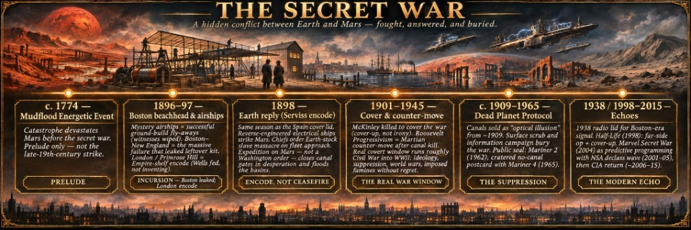

# 1898–1945 CE: Earth↔Mars secret war — high likelihood, off the public books

> **TL;DR:** After the late-19th-century Mars→Earth incursion (Wells as managed disclosure; leftover **flying-machine** as ladder), Earth factions almost certainly mounted a **counterstrike** and then **buried the war**. **Reconstruction locus (Author):** beachhead most likely **Boston / New England**, not London. Serviss 1898: Earth fleet, **canal kill** (field desperation on Mars — not Washington order; Martians **never intended** it), slave purge on approach. **Water stays off** afterward = Martian **hide** from slave-revenge sabotage / next fleet — Dead Planet = concealment, not dry preference. Conquering camp still dominates most of Earth; seat is **political/family** — just as likely **Earth** as **Mars**. Clean Deep State frame: **pro-conquest** (Church / CIA-class) vs **pro-sovereignty** (NSA-class, including false flags). MFEE tip stays **open** (*Ender* child grammar). Dual motive: **project force** and **keep it unowned**. Reader: [*The Secret War*](/cosmos/mars/the-secret-war.md). Dossier: [AU-085](/cosmos/mars/investigations/earth-mars-counterstrike-investigation.md).

**Graphic:** Refreshed banner (2026-11) locks Boston beachhead + airships, Serviss **1898**, canal kill as field desperation, McKinley cover / Progressive counter-move, Dead Planet **~1909–1965** (Mariner 2 **1962** / Mariner 4 **1965**), modern echoes. Older “London Incursion / 1897 Serviss / Mariner 4 (1962)” beads are retired.

---

## Locus for reconstruction: Boston, not London

| Layer | Geography | Role |
| --- | --- | --- |
| **British book / Pearson–Heinemann** | London, Woking, Primrose Hill | Empire-shelf encode; leftover flyer printed here |
| **US serials (*Fighters from Mars*)** | Concord → Lexington → Boston; NJ → New York | Soft history calls this “piracy / unauthorized”; **Author:** later branding, not US law voiding American presses. Closer to the **true beachhead** |
| **Serviss sequel lane** | *Edison’s Conquest* (1898) same US papers | **New American text** — “unauthorized sequel” is modern IP anachronism, not 1898 franchise veto |
| **Edison face** | Soft history: blank-page lone genius | **Author hard-default:** absent convincing inventorship docs, **reverse engineer** not inventor. **Documented in Serviss:** examines Martian engines / flyers / generators with Kelvin, Röntgen et al. Lone-name patents/schoolbooks = whitewash so secret war stays unnamed |
| **Unused X-ray on McKinley** | Fair + Edison NJ machine arrive **1901**; doctors refuse (risk / fear) | **Author:** recent **inheritance** still scary — not mature famous-inventor tech people already trust |
| **Spain 1898** | Soft history’s only war that summer; critics call it skirmish / “organized assassination” / barely a war | **Cover lid**, not identity. **Author:** only earns *war* because secret Mars war ran **inside**; sovereignty stakes = **Catholic Church** (Spain) vs **Constitution** (US) — **pro-conquest** vs **pro-sovereignty** faces; conquering seat is political/family (**Earth-or-Mars open**) |
| **McKinley assassination** | Shot **6 Sep 1901** / dies **14 Sep**; soft history’s “ultimate irony” | **Author major:** cover-up, not irony; killed to **cover the secret war**; tip-alone likely enough; Secret Service = containment layer |
| **TR / Progressive Era** | Soft history: reform cures domestic problems that “triggered” Buffalo | **Author:** conquering-camp **counter-move on Earth** — lose canal ground, win ideology / mass influence; WWs + imposed famines; **not** Mars restoring canals |
| **Canal stay-off / Dead Planet** | Soft history: canals were always illusion; Mars is dead rock | **Author:** Earth expedition closed gates (Martians never intended); **water stays off** = hide from **slave-revenge** / next fleet; Dead Planet = concealment |
| **Deep State frame** | Soft history: Mars HQ / alien species / one monolith | **Author:** **pro-conquest** (Church / CIA-class) vs **pro-sovereignty** (NSA-class; false flags to retake control) |
| **Craft doctrine** | Tripods vs later lift | Tripods = **first beachhead** only; later returns = **flyer / hover** class (don’t re-lose kit) |
| **Height caste** | Thin ≤~6 ft vs giants | **Slave** class vs **warrior/chief** class — Wells bipeds + Serviss giants = hierarchy, not contradiction |
| **Woking Martian statue** | Stainless tripod, **Apr 1998** book centenary | British **claim-stake** on relocated locus — steel where the novel said, not where US serials point |
| **Reconstruction default** | **Boston / New England** | Prefer for ops map, residue hunt, and why England stays quiet while US sky flashes / archival radio need a domestic lid |
| **1938 Mercury Theatre** | US radio “hoax” | SF-redaction cover matching **leaked late-19th-c. Boston-era transmissions**, not a same-decade raid |
| **Artilleryman underground** | Drains / cellars / tunnels / subways | London had Metro from **1863** (mature by 1897); Boston Tremont opens **Sep 1897** as a stub. US forward dig → by **~1940** Boston mid-size, **NYC out-scales London**, Philly Broad/Market, Chicago freight vaults. Dig priority tracks **Boston→NY** attacked corridor. **Open:** bunker/survival underground remapped as transit |
| **Mystery airships 1896–97** | Nationwide US sky wave; short sightings then gone | **Author solution:** artilleryman grammar — **built on ground**, flown away (off-world); successful ops of same class as Boston; **Boston = massive failure** that leaked; *Roosevelt Dispatches* may encode other loci |
| **Witness equation** | Soft history: empty sky = nothing happened | **Author working equation:** most successful missions leave **no witnesses** — perfect execution **exterminates** them; total silence = hard success; novel/kit leak = failed wipe |

**Documented chronology:** *Pearson’s* / *Cosmopolitan* serial (Apr–Dec 1897, London geography) → NY *Evening Journal* / Boston *Post* *Fighters from Mars* (Dec 1897–early 1898) → Wells *Critic* protest (Jan/Mar 1898). Wells alleged **republication with forbidden alterations** after magazine print — Dewey memo, Boston cable “as New York Journal,” his “Agreed” — **not** proven theft of an unpublished draft ([LOC](https://blogs.loc.gov/headlinesandheroes/2022/12/h-g-wells-fighters-from-mars/); [Wikipedia — *Fighters from Mars*](https://en.wikipedia.org/wiki/Fighters_from_Mars)). Soft history flattened that into “piracy.” **Correction:** “unauthorized” on *Fighters* (and especially on Serviss **sequels**) is **later literary / corporate-IP branding**, not America retroactively voiding its own presses — that would be a sovereignty giveaway. Treat the US newspaper lane as American publication history ([AU-085 §1.4b](/cosmos/mars/investigations/earth-mars-counterstrike-investigation.md)).

**Working reconstruction:** New England closer to the real beachhead; British book = Empire encode. **Preferred soft path:** London encode planted early (including Cosmopolitan) so Pearson’s looking earlier is feature; Boston papers keep ground-truer map; Wells protest seals London as “original.” **Author hard stop:** Wells was **fed**, not inventing — [Deeks](/influence/predictive_programming/fiction_encoding/compromised-court-cases-declared-reality-investigation.md)/*Outline* thief pattern rules out lone-genius WotW (case object = *Outline*; inference = operator type). **Harder path (open):** fake London earlier date on paper — needs US ads, accession stamps, printer/postal marks; **not** Wells’s letter as clock. **Jurisdiction:** London court can anoint narrative ownership; US Hearst serial-rights board is a different chessboard. Orson 1938 = [fiction-quarantine](/timeline/evt-mars-literature-as-reclassified-nonfiction) lid for leaking Boston-era wireless, not a same-decade raid. Full: [*The Secret War*](/cosmos/mars/the-secret-war.md) · [AU-085 §1.4b](/cosmos/mars/investigations/earth-mars-counterstrike-investigation.md).

When this timeline says **Primrose Hill flyer**, read **leftover return vessel in the British print**; for reconstruction of where the cylinders actually hit, default to **Boston**.

---

## Why “high likelihood”

1. **Documented leftover kit.** Wells’s *War of the Worlds* ends with a **great flying-machine** (British text: Primrose Hill) under atmospheric test when disease stops the invaders; machines remain for sight-seers. That is a **ladder**, not a prop — whether the true redoubt was New England or the printed London hill.
2. **Immediate encode of reply.** Same publishing season, **same US newspaper lane** as *Fighters from Mars*: Garrett P. Serviss, *Edison’s Conquest of Mars* (1898) — Earth electrical / anti-grav ships, Mars strike, **canal waterworks killed**. **Major:** fleet appears → Martians **mass-butcher** Earth-stock slaves (Aina sole survivor). **Author:** best SF story ever filed; **not retold** (Wells remade forever; Serviss motifs spawn elsewhere) because the incredible story is **true**. Treated here as **realistic filing**, not empty pulp.
3. **Canals seen, then denied.** Schiaparelli/Lowell map a running irrigation signature; later establishment + Mariner seal call it illusion. Author join: **we turned the water off** (field desperation; Martians never intended it). Mars **keeps it off** afterward — hide from slave-revenge sabotage and the next Earth fleet. Dead Planet Protocol is that forced concealment for cameras ([Dead Planet Protocol](/timeline/evt-mars-surface-dismantling-dead-planet-protocol)).
4. **Amnesia needs no mind-wipe.** A war that **cannot be traced to Earth**, plus a thin witness set, produces planetary forgetting without psychic gadgets. Secret-sortie scoreboard (no public after-action): ships that leave and **never return** = **lost**; ships that **return** = **won**. Cover myths fill the gap (bacteria miracle, “just a novel,” canals = illusion, Mars = rock) — and a **wrong-island** novel geography keeps search parties off Boston.
5. **Media keeps teaching the dual motive.** *Half-Life* (1998): HECU contains the outbreak **and** silences witnesses; Abrams wreckage appears on the far side at the G-Man close. Marvel **2004–05 *Secret War***: Nick Fury unauthorized smash vs terror/nuke-class threat, memory-wipe of operators, “necessary” — ships **Apr 2004→Dec 2005** through the [NSA strength window](/timeline/evt-2000-2005-ce-nsa-tonkin-mars-declass-fight). **2015 *Secret Wars*** re-owns the brand as Battleworld cosmic toy-multiverse — **redaction media**: the opposite concept of the NSA-aligned grounded spy story.

Public **nonfiction** books do not carry this war. **Classified** continuity and **genre quarantine** do. Soft history’s “secret war” (Laos, proxy sponsorship) is a different sense of the word — covert theater **inside** a known conflict, not a war with another world that **neither public remembers**.

---

## Political graph (not two sealed planets)

Breakaway / “lost world” language must not imply isolation. At all times there was about **one degree of political separation** — a thin command channel — with mass publics dark on **both** ends. Rulers need not be a nonhuman species; they can be **humans who could reach Mars**. The conquering camp still dominates most of Earth; that rulership is **political and family-oriented** — seat just as likely **Earth** as **Mars**. MFEE (~1774) remains a **prior** catastrophe; tip agency stays **open** (Earth-ordered option; *Ender* child/incomplete-operator grammar — do not name a sealed culprit until actual history). The late-19th-c. secret war is a **later** beat: **Boston-first** (Author) incursion → leftover flyer → reply → canal kill → water stay-off hide → suppression that backfires into amnesia.

Until sealed history is known, the cleanest Deep State depiction is **two camps**: **pro-conquest** (Catholic Church / CIA-class modern faces) vs **pro-sovereignty** (NSA-class — including false flags to retake control). Depression and WWII outcomes fit the conquering camp. After a triumphant strike the poison has **no single root** — identify camps by **actions and motives**, not passport stamps from a red planet.

Wells’s bipeds-as-occupants / not-redacted lock (**AU-084**) explains how the invasion novel survived clean into science fiction. Orson Welles’s 1938 closer then told a mass **American** audience the invader was Halloween costume — not because a Mars raid was live in 1938, but because **old Boston-side signal** still needed a fiction-shaped lid on the SF-redaction wave. Full plain-language walk: [*The Secret War*](/cosmos/mars/the-secret-war.md).

---

## See also

- [*The Secret War* (reader essay)](/cosmos/mars/the-secret-war.md)
- [Earth→Mars counterstrike investigation (**AU-085**)](/cosmos/mars/investigations/earth-mars-counterstrike-investigation.md)
- [WotW Martian analysis (**AU-084**)](/cosmos/mars/investigations/wotw-martian-analysis.md)
- [1896–1897 mystery airship wave](/timeline/evt-1896-1897-mystery-airship-wave)
- [Dead Planet Protocol](/timeline/evt-mars-surface-dismantling-dead-planet-protocol)
- [Mars literature as reclassified nonfiction](/timeline/evt-mars-literature-as-reclassified-nonfiction)
- [2000–2005 NSA Tonkin vs Mars declass](/timeline/evt-2000-2005-ce-nsa-tonkin-mars-declass-fight)
- [*The Sin Eater*](/governance/war/the-sin-eater.md) — Fury / antibody grammar

---

Keywords: #SecretWar #AU085 #Mars #Boston #FightersFromMars #PrimroseHill #Serviss #Wells #DeadPlanet #Canals #HalfLife #Marvel #NSA #CIA #CatholicChurch #TwoCamp #MFEE #PredictiveProgramming #Amnesia
