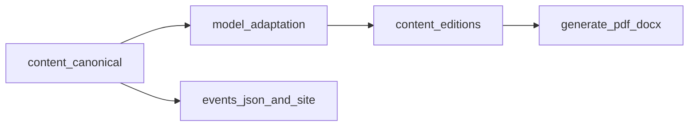

# Audience-specific book editions

This document defines how to produce **print-oriented** variants of the timeline book for **four** audience tracks: **modern Christian** (§3.1), **Zionist Jewish** (§3.2), **modern religious / interfaith** (§3.3 — unified voice for readers of *any* living tradition who want shared history without being asked to switch teams), and **modern educational** (§3.5). Canonical prose for the **live timeline** stays in `content/`; editions live in parallel trees on **`main`**, adapted by **model passes** (new voice, omissions, reframing)—not mechanical string-replacement scripts.

**Relationship:** `content-editions/modern-religious/` is the **live interfaith tree** on disk. It **incorporates** the former **Christian pilot** (`00.*`, `01.*`) and applies **§3.3** voice (interpretation-only, rotated examples). There is **no** separate `content-editions/christian/` folder; a **Christ-centered-only** export remains **specified** in §3.1 as a **voice profile** if you fork from git history or duplicate the tree later. **`jewish/`** may still be added for **Zionist-specific** emphasis; **modern-religious** stays the **default** when the goal is **maximum overlap** and **minimum sectarian framing**.

**Related:** [CONTENT_STRATEGY.md](CONTENT_STRATEGY.md), [INVESTIGATIVE_STRATEGY.md](INVESTIGATIVE_STRATEGY.md), [PRINT_GOALS.md](PRINT_GOALS.md), [FEEDBACK.md](FEEDBACK.md).

**FAQ (timeline):** [TIMELINE_FAQ.md](TIMELINE_FAQ.md) at `docs/TIMELINE_FAQ.md` — **repo-only editorial tool**: it **does not** ship **inside** any book PDF/DOCX/export. Use it to **rank concerns** and **steer narrative** so chapters **preempt** skeptic objections **in prose**; same for [FEEDBACK.md](FEEDBACK.md).

---

## 1. Architecture (why not long-lived branches)

- **Single source of truth for the site:** `content/**/*.md` drives `scripts/build-events-from-content.py` and committed `data/events.json`. CI expects every `md_path` in `events.json` to exist under `content/`.
- **Print today:** `scripts/generate-pdf.py` and `scripts/generate-docx.py` use `CONTENT_DIR = REPO_DIR / "content"` and scan all `*.md` there. There is **no edition switch** yet (see Phase 2 below).
- **Precedent:** `scripts/export-russian-remote.sh` already treats some exports as separate from canonical English `content/` for the web app.

Replacing `content/` on **three perpetual branches** would either break timeline validation for those branches or require maintaining divergent `events.json` trees. Prefer **parallel directories on `main`**.

**Convention (chosen):** edition markdown under:

- `content-editions/modern-religious/` — **interfaith** “modern religious perspective” (see §3.3); **current** **pilot** **tree** (`00.*`, `01.*` and onward).
- `content-editions/jewish/` — **Zionist-perspective** Jewish edition (see §3.2); planned; folder name unchanged for path stability when created.
- `content-editions/educational/`

**Short-lived branches** are fine for batch work, then merge to `main`. Avoid branches where canonical `content/` diverges from `main` unless the whole product forks.

---

## 2. Mirroring: paths, filenames, titles

- **Mirror** the same **relative paths** and **`XX.YY.ZZ-slug.md` filenames** as `content/` for every chapter that appears in an edition.
- **Titles differ on purpose:** the first `#` heading in an edition file **may and often should** differ from canonical.
- **No `events.json` coupling:** edition files are **not** fed into `build-events-from-content.py`.

**Syncing when canonical changes:** copy from `content/`, then model-adapt the edition copy; optional YAML `canonical_path`, `source_commit:`.

---

## 3. Product goals per edition

| Edition | Aim |
|--------|-----|
| **Christian** | **Pro-Christian narrative:** center **the deity of God the Father and of Jesus Christ**. Frame **medieval and early modern Christianity as at war with itself** — **institutional and imperial church channels** versus **ordinary believers** — from antiquity forward; this supports a **shorter chronology** reading without blaming **lay faith**. Tie **Fomenko** (where used) to **Latin/Western institutional** culpability: **hiding or encrypting Christ’s name in year dating and chronology** as part of record-keeping, **not** an indictment of **common Christians**. See §3.1, §11. |
| **Jewish (Zionist)** | **Jews are not** cast as architects of **global schemes**; narrative allows that **Jewish communities were used** by **imperial actors** (e.g. **British**) alongside **engineered religious boundaries** and **conflicts** (including **geopolitical pressure on Russia**). **Omit circumcision** and any **monotheism-as-cult** framing. **Elevate** shared **Horde / imperial** past: **Jews, Christians, Muslims (and others)** as **one religious civilization** under **Rus-Horde** continuity until **later splits**. **Highlight** early **Jewish–Christian (gnostic-flavored) continuity** as **one religion** until roughly the **Kremlin–Ottoman** fault line (**17th century** — **date to verify** in research pass). See §3.2, §11. |
| **Modern religious (interfaith)** | **One book, many homes:** address **Muslims, Hindus, Christians, Jews, Buddhists, Sikhs, Jains, Zoroastrians, Indigenous traditions**, and **any lineage** that remembers **sacred history** — on the thesis that **convergence in myth, calendar, and catastrophe memory** is **evidence of a shared past**, not a demand that anyone **convert** or **downgrade** their faith. **Method:** **interpretation only** — show how **each tradition’s own texts and practices** can **absorb** alternate chronology and cosmic history **without** new dogmas or **replacing** core commitments. **Combine** Christian **institution vs. pew** and Jewish **imperial use / no collective Jewish mastermind** into **neutral** language: **archives, courts, and presses** tilt memory; **ordinary believers** across religions are **not** treated as authors of **wars and forgeries**. **Science-light** like other religious editions. See §3.3. |
| **Educational** | **Science-full:** keep **canonical-level** physics/cosmology/chronology argument (EU, SAFIRE, etc.) where the main book has it. **Editorial priority list:** use **`docs/TIMELINE_FAQ.md`** and **`docs/FEEDBACK.md`** only **off-manuscript** — to **order** which **concerns** the narrative should **address first** (framing, separability of NC vs cosmic threads, Fomenko wording, genre confusion, etc.). **Book body** stays **ordinary chapters**; **do not** paste FAQ Q&A into the book or appendix. Goal: **honest framing**, **separate hypotheses**, **named sources**. Curriculum-safe tone; **no sensationalism**. See §3.5. |

### 3.1 Christian edition — “other gods,” institutions, and voice

- **Mythic planets** = **what the nations called gods**; the **OT** itself acknowledges **other gods** in the sense of **forbidden objects of worship** / **heavenly powers** (e.g. Exodus 20:3–5; Deuteronomy 4:19) — **not** beings equal to the **Trinity**.
- **Science-light in these editions:** **omit or drastically shorten** EU/plasma/**laboratory** argumentation (SAFIRE, Peratt detail, etc.). Keep **celestial drama** as **theological–historical** narrative aligned with Scripture’s world-picture, not as a physics textbook. Use this profile for a **Christ-only** fork if separated later; **modern-religious** pilot on disk follows §3.3 (see §9).
- **Voice:** **third person** and **“we”** for the narrative — **approved**; avoid implying false biography about the compiler.

### 3.2 Zionist Jewish edition — specifics

- Same **science-light** rule: **planets as mythic/OT “gods,”** not **EU technical proofs**.
- **Do not** discuss **circumcision** in this edition.
- **Do not** portray **Jewish power** as secretly running the world; **do** allow **documented or argued imperial use** of **populations and confessions** as **chess pieces**.
- Claims that **imperial actors “invented” Islam** or **religion X to destroy Russia** are **explosive**: present only as **hypothesis** with **named sources**, **dates**, and **alternative readings**, or **omit**. Never echo **classic antisemitic** or **Islamophobic** memes **without** that scaffolding.

### 3.3 Modern religious (interfaith) edition — **interpretation covenant**

**Core promise (reader-facing):** this book **does not** ask anyone to **leave** their religion, **rank** God(s), or **accept** a new creed. It offers **one more layer of interpretation** — how **overlapping memories** (flood, lawgivers, sky powers, calendar shocks, empire) might **fit together** if **records** were **curated** and **timelines** **compressed or duplicated**. **Proof** is **historical and comparative**: parallel stories, parallel dates, parallel suspicions about **who kept the books**.

**Voice and framing**

- **Third person + “we”**; **no** narrator-as-convert-maker; **no** “only we have the real God.”
- When **Christians** are addressed, do so **alongside** **Muslims** (People of the Book, shared prophets), **Jews** (Tanakh / shared narratives), **Hindus** (cosmic cycles, *manvantara*-scale time, avatars — **without** flattening schools into a cartoon), **Buddhists** (wheel, kalpa language — **careful** not to **Buddha-jack** chronology claims), and **others** — **rotate examples** so **no** single chapter reads as **one tradition’s tract**.
- **Supersessionism:** avoid **triumphalist** “your religion is secretly ours.” Prefer **“parallel witness”** and **“institutional drift”** language.
- **“Other gods” / heavenly powers:** same **toolkit** as §3.1 — **powers the nations knew** as **gods** or **lords of heaven** in **text and cult**, **not** a lecture on **who is ontologically ultimate**; let **each reader** map that onto **their theology**.
- **Figures held sacred:** **no** **mockery**, **no** **cheap psychologizing** of **Muhammad**, **Krishna**, **the Buddha**, **Moses**, **Christ**, **Mary**, etc.; **disputed history** is **hypothesis + sources**, **not** **slurs**.
- **Science-light:** celestial narrative as **witness and pattern**, **stubs** to canonical **`content/`** for **EU / plasma** depth.

**Inherits from §3.4** all **Martians omit**, **Deep State hypothesis hygiene**, **God/Satan essay** option, **LXX/MT** where relevant, **Exodus** shared thesis (cultic/attention bondage; **natural-catastrophe** openness; **no** **ethnic blame**), **institutions vs. laity**, **Catholic documented history** without **attacking lay Catholics**, **Protestant managed-opposition late**, **Russia–Ukraine + Armenian Genocide**, **mudflood/giants**, **no Christ as giant**.

**Workflow**

- **Source text:** start from **`content/`** or **existing** **`content-editions/modern-religious/`**, then **diff** against **Jewish brief** (§3.2) where relevant and **neutralize** **tradition-exclusive** titles where a **shared** heading serves better; **add** **non-Western** parallels **per chapter cluster**.
- **YAML:** `edition: modern-religious` (or `interfaith` if you prefer a single token — pick one and keep it).

### 3.4 Shared — Christian, Zionist, and modern-religious editions

**Omit entirely**

- **Martians**, **Martian civilization**, **breakaway civilizations**, and similar **speculative non-human** storylines.

**Deep state (hypothesis framing)**

- Treat **long-horizon institutional manipulation** as **unprovable but pattern-consistent** — **never** as a **single proven cabal**. Language: **tendency**, **incentive**, **documented episodes** where they exist.

**God, devil, Satan (add depth)**

- Add **expanded context** (these editions may be **longer** than canonical where needed): **history of ideas** — how **God** and **Satan/devil** became **two opposed personae** in **popular modern religion**, versus older patterns where **one divine figure** could show **terrible and merciful aspects** (and **“gods”** plural in culture). **Cited** philology/theology sources; **no** **final dogmatic** closure.

**Chronology / dates**

- Prefer **Old Testament–anchored** date **clusters** where both traditions allow; present **Septuagint and Masoretic** (and related) **both** with **extra context** — **approved**.

**Exodus / Egypt–Israel bridge (Christian, Jewish, and modern-religious editions — shared thesis)**

- **Editorial reading:** the **Exodus** complex is interpreted as unfolding **before** a social-technical regime where **organized chattel slavery** (mass **controllable** labor markets) was **possible** as in later antiquity/modernity. Populations were **not** yet as **vulnerable to large-scale physical bondage** as in later systems; coercion took **other forms**.
- **Deep State / imperial attention (Dark Ages lens):** narrative allows that **long-horizon manipulators** worked to **capture attention** and **ritual obedience** — **sacrifice** and **cultic mental bondage** common; **physical slavery** in the **modern sense** is **not** the book’s reading of that era. **“Slave” language** in later **translation and polemic** is flagged for **investigation** (philology, institutional publishing).
- **Leadership:** **Exodus-related** figures as **technical–cultic mediators** (claims to speak for **God / gods**) — **not** a cartoon of **Jewish slavemasters** or **Egyptian racial villains**.
- **Failure of prestige:** **Exodus** as **collapse of priestly prediction and trust**; people **narrate for themselves** without centralized mediators — reduces **eternal “Egyptian vs Jew”** racism to **later mythmaking**.

**Zionist edition — Exodus emphasis (adds to the above)**

- **Correct** the popular **Exodus** narrative **without** blaming **Jews** or **Egyptians** for a **morally charged fable** of **innate group guilt**.
- Prefer a **natural-catastrophe** reading: events interpreted **then** as **divine wrath or intervention** — **meteorology, river, plague, or cosmic shock** left **open** — rather than **ethnic crime** stories.

**Christian edition — Exodus**

- Same **shared thesis** above; **theological** language may name **YHWH’s** action **without** turning **Egyptians** into **irredeemable types** or **Israel** into **slave-drivers**.

**Idols, mechanisms, priestcraft**

- **Ambiguous by design:** **do not** explain **how idols “worked.”** Note **Scripture’s own portrait of doubt** toward **those who claimed to speak for gods**. **Only** what **citable literature** supports; **reader** draws conclusions.

**Institutions, wars, blame**

- **Church institution** (and analogues) as **locus of record-keeping and discipline** — but **corrupting influences** framed as **often external**: e.g. **British imperial mass publication** of **redacted** sacred texts, **forced spread** under **conquest**.
- **Bottom line:** **ordinary religious people** are **not** the **moral authors** of **religious wars**; **wars** are **often triggered in secret** by **nihilist or post-religious strategic actors** using **mass deception**. Still **attribute** specific **battles** to **named** **kings, states, and documents** where possible — **hypothesis** does not replace **evidence**.
- **Catholic institutional history:** **fair** exposure of **documented abuse** — **crusading violence**, **Inquisition**, **political entanglement**, **chronology/record power** — **early and mid-book** where the narrative requires it. This is **not** an attack on **lay Catholics** today; it parallels the **institutional vs. common believer** split used elsewhere.
- **Protestantism and “managed opposition”:** **do not** foreground this **early** — avoid **needlessly offending** Protestant readers before **trust** is built. Place the **full Protestantism-as-controlled-opposition** argument **late**, inside the **dedicated controlled-opposition section/chapter**, with **sources** and **nuance** (movements are **mixed**; thesis targets **power geometry**, not **every believer**).

**Controlled opposition — full treatment (placement)**

- **Include** the **full arc**; **Russia–Ukraine** as **ongoing** with **long-running scars** between **religious communities** in the **wider region** — **not** a **closed** 2022–24 headline only.
- **Armenian Genocide:** **include** as part of **20th-century religious–ethnic trauma** and **great-power** **geometry** (who armed whom, who recognized what) — **sourced**, **sensitive** wording; **no** **denial** frame.

**Protestantism** (late section only): framed as **managed opposition**, **not** **pure spontaneous** resistance to **Orthodoxy** — **argued with sources**, not as **slur against all Protestants**.

**Mudflood, giants**

- **Include** **mudflood** and **giants** threads; **causation** stays **ambiguous** (no **forced EU mechanism**).
- **Do not** identify **Christ** as a **giant** or **Nephilim-style** figure.
- Emphasis: **religious aftermath** — **more division**, **apocalyptic anxiety**, **intra-faith killing** over **trivial** **disputes**.

### 3.5 Educational edition — `TIMELINE_FAQ.md` + `FEEDBACK.md` (**editorial only**)

**These files are not book content.** They live in **`docs/`** for **authors and editors** only. **No edition** includes them as **chapters**, **appendix paste**, or **linked “FAQ section”** in the print artifact — unless you **explicitly** choose a **separate** non-book deliverable later.

**Workflow**

1. **Read** **[TIMELINE_FAQ.md](TIMELINE_FAQ.md)** and **[FEEDBACK.md](FEEDBACK.md)** to build a **priority list** of **what educated skeptics reject** and **why**.  
2. **Shape** `content-editions/educational/` (or canonical `content/` when shared) so **narrative** and **framing** **absorb** those concerns **where the story naturally belongs** — e.g. **separate** **Fomenko / NC** from **Saturnian / 4077 BCE** before readers **confuse genres**; fix **Fomenko / RAS** wording per **FB-001**; **one-sentence** **Mars vs Martians** disambiguation where needed.  
3. **Use** FAQ answers as **models** for **tone** (both sides, deadlock) — **not** as **text to copy** into the manuscript.

**Concrete hygiene (from FB-001):** never imply **Russian state sponsorship** of **New Chronology** without a **cited grant/decree**; **RAS** membership = **mathematics**, not **academy endorsement** of **NC**; **disambiguate** **Mars the planet / myth** vs. **extraterrestrial “Martians”** where the chapter touches both. **Goal:** **science-full** book that **earns** fewer **avoidable** dismissals — **without** turning **`docs/`** into **printed** matter.

---

## 4. Non-negotiable guardrails

### 4.1 Antisemitism, Islamophobia, and interfaith hygiene (Christian, Jewish, modern-religious)

No **antisemitic** tropes: collective blame, cabal mastermind, blood libel, “fake Jews,” essentialist conspiracy. The **Zionist** edition **explicitly rejects** “**Jews run the world**” while allowing **imperial abuse of** **Jewish and other** **peoples** — still **requires** **sourcing** and **careful** wording.

**Islam:** avoid **invented-religion** claims **as** **bare** **slurs**; if **the thesis** appears, it must be **hypothesis**, **attributed**, **debated**, with **mainstream Islamic** and **critical** **sources** **named**.

### 4.2 Monotheism / “cult”

**Remove** **monotheism-as-cult** narrator voice in **Christian, Jewish, and modern-religious** editions (see earlier plan). **Circumcision:** **omit** in **Jewish** edition per §3.2; **modern-religious** follows **same** **omission** unless a **chapter** **explicitly** **requires** **neutral** **mention** **for** **comparative** **history** (**sourced**, **non-sensational**).

### 4.3 Educational edition

**Science-full** and **skeptic-facing** (see §3.5). Compare **documented** views **without** **religious-edition** polemic; **do** adopt **clear genre labels** (NC vs. Saturnian vs. EU) per [FEEDBACK.md](FEEDBACK.md) **FB-001** lessons. **`TIMELINE_FAQ.md` stays in `docs/`** — not an appendix or chapter.

---

## 5. Content matrix (editorial checklist)

Extend rows to match §3.4 (Martians, EU science, mudflood, controlled opposition, British print, Exodus, LXX/MT, God/Satan essay, etc.).

| Topic cluster | Christian | Jewish (Zionist) | Modern religious | Educational |
|---------------|-----------|------------------|------------------|-------------|
| EU / plasma / SAFIRE | Omit or stub | Omit or stub | Omit or stub; **rotate** **non-Western** **parallels** in prose | **Full** (science-full) |
| Martians / breakaway civs | Omit | Omit | Omit | **Full** + **disambiguation** (planet/myth vs. aliens) |
| Controlled opposition | Full; **Protestant thesis late** | Full; **Protestant thesis late** | Full; **same** **late** **placement**; **no** **single-tradition** **villain** **arc** | Full; **Catholic/Protestant** **framed** **clinically** |
| Catholic institutional critique | **Early/mid** where needed | As relevant | **Documented** **power** **over** **records**; **not** **anti–lay** **Catholic** | **Documented** history |
| Russia–Ukraine + Caucasus | **Ongoing** scars + **Armenian Genocide** | Same | Same; **sensitive** **to** **Muslim**/**Christian**/**Jewish** **readers** | Same; **clinical** **sourcing** in prose |
| Fomenko / chronology | Pro-Christian institutional reading | TBD / sourced | **Attribute** **Fomenko**; **institutional** **record** **angle** **without** **forcing** **one** **creed** | **NC vs cosmic** **separated** |
| Interfaith voice | N/A (Christ-centered) | N/A (Zionist lens) | **Interpretation-only**; **parallel** **witness**; **no** **conversion** **ask** | N/A |
| `TIMELINE_FAQ.md` + `FEEDBACK.md` | **N/A** (not in book) | **N/A** | **N/A** | **Priority guide** for **rewrites** only |

---

## 6. Model-driven adaptation workflow (not scripts)

- **Inputs:** canonical file, **edition brief** (this doc §3–4), matrix row, link rules.
- **Output:** `content-editions/<edition>/...`; **rewrite `#` titles**; **keep filenames**.
- **QA:** antisemitism/Islamophobia pass; **Hindu/Muslim/Buddhist** **dignity** pass on **modern-religious**; **no Christ-as-giant**; **no cult framing**; **sourcing** on **imperial religion** claims.

---

## 7. Phase 2 — export tooling (after editorial sign-off)

`CONTENT_ROOT` / `--content-root` or npm scripts per edition; optional `edition-manifest.json` for **omits** (e.g. all Martian chapters).

---

## 8. Flow (reference)

---

## 9. Pilot status — `modern-religious` chapters 00–01

**Done:** `content-editions/modern-religious/00.overview/` (10 files) — interfaith voice per §3.3, science-light, Fomenko framing, stubs to canonical physics where needed (merged from former Christian pilot + editorial pass).

**Done:** `content-editions/modern-religious/01.before-creation/` (5 files) — mirrors canonical paths; narrative science-light; `01.02.01` stub; interfaith adjustments to spawning/scalar chapters; prose per `CONTENT_MARKDOWN_STYLE`.

**Removed:** `content-editions/christian/` (content lives under **`modern-religious/`**).

**Not done:** `TL;DR` **TODO**s on edition files; export **CONTENT_ROOT** (phase 2).

**Next:** `modern-religious` `02.*` onward; Zionist and educational trees; optional **Christ-only** tree only if forked for a separate print product.

---

## 10. Editorial decisions — **resolved**

| # | Topic | Decision |
|---|--------|----------|
| Voice | Narration | **Third person + “we”** — approved. |
| LXX vs MT | Creation / OT dates | **Present both** with **extra context** — approved. |
| Controlled opposition | Depth | **Full coverage**; **Russia–Ukraine** **ongoing** + **regional religious scars**; **Armenian Genocide** included (**sourced**); **Protestantism as managed opposition** (sourced) — **late in book only** so **Protestant** readers are not **ambushed early**. |
| Catholic church | Placement / tone | **Highlight bad institutional history** (**fair**, **documented**) — **earlier** than **Protestant CO** thesis; **not** an attack on **lay Catholics**. |
| Mudflood / giants | Include? | **Yes**; **ambiguous cause**; **no Christ as giant** — approved. |
| Science | EU / lab | **Largely omit** in **Christian, Jewish, and modern-religious** editions; **myth + heavenly-powers** language without **physics deep dive** — approved. |
| Educational | Scope | **Science-full**; **`docs/TIMELINE_FAQ.md` + `FEEDBACK.md`** used **only** to **prioritize** narrative fixes — **not** pasted into books — approved (2026-03-29; clarified). |
| Exodus | Both religious | **Before** era of **organized chattel slavery** as book reads it; **attention/cult** bondage and **sacrifice**; **not** **physical slavery** in **modern sense**; **Deep State** drawing populations in **Dark Ages** framing; **Zionist:** **natural disaster** reading, **no** blame on **Jews** or **Egyptians** — approved (2026-03-29). |
| Blame / wars | Religion vs actors | **Institutions + external imperial print**; **lay believers not blamed**; **secret nihilist/strategic deception** as **interpretive lens** — approved; still **cite** where **claims** are **strong**. |
| Modern religious (interfaith) | Goals | **Interpretation-only** covenant; **shared history** as **evidence** of **common** **memory**; **no** **conversion** **ask**; **Muslim/Hindu/Buddhist/Sikh/Jain/Zoroastrian/Indigenous** **examples** **rotated** — approved (2026-03-29). |

---

## 11. Open questions (remaining)

1. **Kremlin–Ottoman split:** exact **century/event** to anchor “**Jewish–gnostic Christian** **single religion** until split” — **confirm** primary sources and **avoid anachronistic** “gnostic” label if **misleading**.
2. **“Invented Islam” thesis:** which **authors** and **works** are **canonical** for this project’s **argument**? (Required before writing **Jewish** edition chapters touching **Islam**.)
3. ~~**Christian pilot rewrite**~~ **Done** for **00–01** (stubs + science-light); **recheck** when **02+** is drafted for **voice consistency**.
4. **Fomenko “Christ hidden in dates”:** always **attribute to Fomenko** explicitly, or **internalize** as **edition narrator**? (Affects **tone** and **defamation** risk re **living churches**.)

**Resolved:** **`TIMELINE_FAQ.md` is not book content** — it **guides priority and narrative focus** only (2026-03-29).

Answer §11 when you can to **lock** the **next** conversion batches.

---

## 12. Risk note (editorial hygiene)

Imperial **narratives** that tie **religion**, **Russia**, and **“invented” faiths** together are **historically weaponized**. These editions **must** **interleave** **hypothesis language**, **named sources**, and **counterargument** — **especially** in **public** or **translation** releases — so **good-faith** readers **cannot** read **accidental** **blood libel** or **sectarian incitement** into the text.

The **modern-religious** edition **maximizes** **reputational** **risk** and **reward**: **one** **awkward** **phrase** about **another** **tradition’s** **founders** or **rites** can **lose** **every** **reader** from **that** **community**. **Peer** or **in-community** **review** for **Islamic**, **Hindu**, **Buddhist**, and **other** **chapters** is **strongly** **advised** before **wide** **release**.
