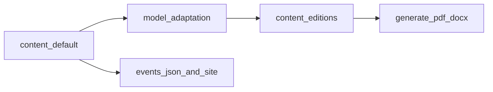

# Audience-specific book editions

This document defines **three** book products:

1. **Default (canonical) edition** — `content/**/*.md`: the **live timeline** and **source of truth** for `events.json` and the site. **Science-full** where chapters include EU, plasma, chronology detail, etc.
2. **Religious edition** — `content-editions/modern-religious/`: **interfaith**, **interpretation-only**, **science-light** adaptation of (1) for print readers who practice a living religion (see §3.2).
3. **Educational edition** — `content-editions/educational/`: **science-full** like (1), with narrative shaped using **`docs/TIMELINE_FAQ.md`** and **`docs/FEEDBACK.md`** as **off-manuscript** priority guides only (see §3.4).

Editions (2) and (3) live in **parallel trees on `main`**, adapted by **model passes** (voice, omissions, reframing)—not mechanical string-replacement scripts. Both **derive from** the default edition; they do not replace `content/` for the web app.

**Related:** [CONTENT_STRATEGY.md](CONTENT_STRATEGY.md), [INVESTIGATIVE_STRATEGY.md](INVESTIGATIVE_STRATEGY.md), [PRINT_GOALS.md](PRINT_GOALS.md), [FEEDBACK.md](FEEDBACK.md).

**FAQ (timeline):** [TIMELINE_FAQ.md](TIMELINE_FAQ.md) at `docs/TIMELINE_FAQ.md` — **repo-only editorial tool**: it **does not** ship **inside** any book PDF/DOCX/export. Use it to **rank concerns** and **steer narrative** so chapters **preempt** skeptic objections **in prose**; same for [FEEDBACK.md](FEEDBACK.md).

---

## 1. Architecture (why not long-lived branches)

- **Single source of truth for the site:** `content/**/*.md` drives `scripts/build-events-from-content.py` and committed `data/events.json`. CI expects every `md_path` in `events.json` to exist under `content/`.
- **Print today:** `scripts/generate-pdf.py` and `scripts/generate-docx.py` use `CONTENT_DIR = REPO_DIR / "content"` and scan all `*.md` there. There is **no edition switch** yet (see Phase 2 below).
- **Precedent:** `scripts/export-russian-remote.sh` already treats some exports as separate from canonical English `content/` for the web app.

Replacing `content/` on **perpetual branches** would break timeline validation or require divergent `events.json` trees. Prefer **parallel `content-editions/` directories on `main`** for (2) and (3).

**Convention (chosen):**

- **`content/`** — default edition (canonical).
- **`content-editions/modern-religious/`** — religious edition (current pilot: `00.*`, `01.*` and onward).
- **`content-editions/educational/`** — educational edition (planned).

**Short-lived branches** are fine for batch work, then merge to `main`. Avoid branches where canonical `content/` diverges from `main` unless the whole product forks.

---

## 2. Mirroring: paths, filenames, titles

- **Mirror** the same **relative paths** and **`XX.YY.ZZ-slug.md` filenames** as `content/` for every chapter that appears in an edition under `content-editions/`.
- **Titles differ on purpose:** the first `#` heading in an edition file **may and often should** differ from canonical.
- **No `events.json` coupling:** `content-editions/**` files are **not** fed into `build-events-from-content.py`.

**Syncing when canonical changes:** copy from `content/`, then model-adapt the edition copy; optional YAML `canonical_path`, `source_commit:`.

---

## 3. Product goals per edition

| # | Edition | Location | Aim |
|---|--------|----------|-----|
| **1** | **Default (canonical)** | `content/` | Full timeline for **web and repo readers**; **investigative** and **science-full** where the chapter requires it; **drives** `events.json`. |
| **2** | **Religious (interfaith)** | `content-editions/modern-religious/` | **One book, many homes:** Muslims, Hindus, Christians, Jews, Buddhists, Sikhs, Jains, Zoroastrians, Indigenous traditions, and others — **interpretation only**; **convergence** in myth, calendar, and catastrophe memory as **evidence of shared past**; **no** conversion ask. **Science-light**; **stubs** to canonical `content/` for EU/plasma depth. **Institutions vs. lay faithful**; **no** collective **Jewish** mastermind; **no** circumcision focus; **Exodus** without ethnic blame; **natural-catastrophe** reading open. See §3.2–§3.3. |
| **3** | **Educational** | `content-editions/educational/` | **Science-full** like (1); use **`TIMELINE_FAQ.md` + `FEEDBACK.md`** only **off-manuscript** to **prioritize** rewrites; **do not** paste into the book. **Honest framing**, **separate hypotheses**, **named sources**. See §3.4. |

### 3.1 Default canonical edition (`content/`)

- **Role:** authoritative **timeline prose** for **paradigmthreat.net** (and exports that scan `content/`).
- **No separate “Christian” or “Jewish” tree:** denomination-specific voice lives only as **optional phrasing** inside **religious** adaptation if you later split chapters—not as a third `content-editions/` folder.
- **Fomenko, EU, Mars, chronology:** present as in each chapter; **educational** edition may add **FAQ-driven** clarifications without changing this tree’s event IDs.

### 3.2 Religious edition — **interpretation covenant** (`modern-religious/`)

**Core promise (reader-facing):** this book **does not** ask anyone to **leave** their religion, **rank** God(s), or **accept** a new creed. It offers **one more layer of interpretation** — how **overlapping memories** (flood, lawgivers, sky powers, calendar shocks, empire) might **fit together** if **records** were **curated** and **timelines** **compressed or duplicated**. **Proof** is **historical and comparative**.

**Jewish communities and antisemitism hygiene (folded from former Zionist brief):** **Jews are not** cast as architects of **global schemes**; narrative may allow that **Jewish communities were used** by **imperial actors** (e.g. **British**) alongside **engineered religious boundaries** — **only** with **sourcing** and **careful** wording. **Omit circumcision** unless a chapter **requires** neutral comparative mention (**sourced**, **non-sensational**). **Elevate** shared **Horde / imperial** past where evidence supports it: Jews, Christians, Muslims (and others) as **overlapping** civilization memory—not a **replacement** for any community’s self-understanding.

**Voice and framing**

- **Third person + “we”**; **no** narrator-as-convert-maker; **no** “only we have the real God.”
- **Rotate examples** across Muslims, Jews, Christians, Hindus, Buddhists, and others so **no** single chapter reads as **one tradition’s tract**.
- **Supersessionism:** avoid triumphalist “your religion is secretly ours.” Prefer **parallel witness** and **institutional drift**.
- **“Other gods” / heavenly powers:** powers the nations knew as **gods** or **lords of heaven** in **text and cult** — readers map ontology onto **their** theology (cf. Exodus 20:3; Qur’anic *shirk*; other traditions’ language).
- **Figures held sacred:** **no** mockery or cheap psychologizing of Muhammad, Krishna, the Buddha, Moses, Christ, Mary, etc.; disputed history = **hypothesis + sources**.
- **Science-light:** celestial narrative as **witness and pattern**; full physics on **`content/`**.

**Workflow:** start from **`content/`** or existing **`content-editions/modern-religious/`**; **neutralize** tradition-exclusive titles where a **shared** heading serves better; **add** non-Western parallels per chapter cluster. **YAML:** `edition: modern-religious`.

**Mythic planets / Scripture:** same toolkit as in Abrahamic exegesis — **planets as what nations called gods**, not rivals to **your** account of the Creator unless **your** tradition says so; **not** EU technical proofs in running prose.

### 3.3 Religious edition — **shared narrative policies** (content checklist)

**Omit entirely**

- **Martians**, **Martian civilization**, **breakaway civilizations**, and similar **speculative non-human** storylines.

**Deep state (hypothesis framing)**

- Treat **long-horizon institutional manipulation** as **unprovable but pattern-consistent** — **never** as a **single proven cabal**. Language: **tendency**, **incentive**, **documented episodes** where they exist.

**God, devil, Satan (add depth)**

- Add **expanded context** where needed: **history of ideas** — how **God** and **Satan/devil** became **two opposed personae** in **popular modern religion**, versus older patterns. **Cited** sources; **no** **final dogmatic** closure.

**Chronology / dates**

- Present **Septuagint and Masoretic** (and related) **both** with **extra context** where this book cites biblical chronology.

**Exodus / Egypt–Israel bridge**

- **Editorial reading:** the **Exodus** complex unfolds **before** organized chattel slavery as modernity knows it; coercion as **attention**, **cult**, **sacrifice** — **not** the book’s reading of “slave” in the **modern** labor-market sense. **Leadership:** mediators claiming to speak for **God / gods** — **not** cartoons of **Jewish slavemasters** or **Egyptian racial villains**. **Failure of prestige:** collapse of centralized priestly trust; reduces eternal “Egyptian vs Jew” racism to **later mythmaking**.
- **Natural-catastrophe** reading **open:** meteorology, river, plague, cosmic shock — **not** ethnic crime fables; **no** blame on **Jews** or **Egyptians** for **innate group guilt**.
- **Theological** language may name **YHWH’s** action for readers who use it **without** irredeemable typing of Egyptians or Israelis as **slave-drivers**.

**Islam (explosive claims)**

- **Invented-religion**–style theses: **only** as **hypothesis**, **attributed**, **debated**, with **named sources** and **alternatives** — or **omit**. Never bare **Islamophobic** memes.

**Idols, mechanisms, priestcraft**

- **Ambiguous by design:** **do not** explain **how idols “worked.”** Only what **citable literature** supports.

**Institutions, wars, blame**

- **Church** (and analogues) as **record-keeping** locus; **external** imperial print and conquest as **often** **corrupting**. **Ordinary believers** are **not** moral authors of **religious wars**; **nihilist/strategic deception** as **lens** — still **cite** battles to **named** actors.
- **Catholic institutional history:** **fair**, **documented**; **not** an attack on **lay Catholics** today.
- **Protestant “managed opposition”:** **late** in book only, **sourced**, **nuanced**.

**Controlled opposition**

- **Russia–Ukraine** **ongoing**; **Armenian Genocide** included (**sourced**, **sensitive**); **no** denial frame.

**Mudflood, giants**

- **Include**; **causation** **ambiguous**. **Do not** identify **Christ** as **giant** / **Nephilim** figure.

### 3.4 Educational edition — `TIMELINE_FAQ.md` + `FEEDBACK.md` (**editorial only**)

**These files are not book content.** They live in **`docs/`** for **authors and editors** only.

**Workflow**

1. **Read** **[TIMELINE_FAQ.md](TIMELINE_FAQ.md)** and **[FEEDBACK.md](FEEDBACK.md)** to build a **priority list**.
2. **Shape** `content-editions/educational/` (or canonical `content/` when shared) so narrative **absorbs** those concerns **where the story belongs** — e.g. **separate** **Fomenko / NC** from **Saturnian / 4077 BCE**; **Fomenko / RAS** wording per **FB-001**; **Mars vs Martians** disambiguation.
3. **Use** FAQ as **tone models** — **not** pasted text.

**Concrete hygiene (FB-001):** never imply **Russian state sponsorship** of **NC** without **cited** evidence; **RAS** = **mathematics**, not **NC endorsement**. **`TIMELINE_FAQ.md` stays in `docs/`**.

---

## 4. Non-negotiable guardrails

### 4.1 Antisemitism, Islamophobia, and interfaith hygiene

No **antisemitic** tropes: collective blame, cabal mastermind, blood libel, “fake Jews,” essentialist conspiracy. Prose **must** **reject** “**Jews run the world**” while allowing **argued** **imperial use** of **populations** — **with sourcing**.

**Islam:** no **invented-religion** claims as **bare slurs**; **hypothesis**, **attributed**, **debated**, **sources** **named**.

### 4.2 Monotheism / “cult”

**Remove** **monotheism-as-cult** narrator voice in **religious** edition.

### 4.3 Educational edition

**Science-full** and **skeptic-facing** (see §3.4). **Clear genre labels** (NC vs. Saturnian vs. EU) per [FEEDBACK.md](FEEDBACK.md).

---

## 5. Content matrix (editorial checklist)

| Topic cluster | Default `content/` | Religious | Educational |
|---------------|-------------------|-----------|-------------|
| EU / plasma / SAFIRE | As in chapter | Omit or stub; rotate non-Western parallels in prose | **Full** + clarity |
| Martians / breakaway civs | As in chapter | **Omit** | **Full** + disambiguation |
| Controlled opposition | As in chapter | Full; Protestant thesis **late** | Full; clinical framing |
| Catholic institutional critique | As in chapter | Documented power; not anti–lay Catholic | Documented history |
| Russia–Ukraine + Caucasus | As in chapter | Ongoing; sensitive to Muslim/Christian/Jewish readers | Clinical sourcing |
| Fomenko / chronology | As in chapter | Attribute Fomenko; no forced single creed | **NC vs cosmic** separated |
| Interfaith / interpretation | N/A | **Interpretation-only**; no conversion ask | N/A |
| `TIMELINE_FAQ.md` + `FEEDBACK.md` | N/A (not in book) | **N/A** | **Priority guide** for rewrites only |

---

## 6. Model-driven adaptation workflow (not scripts)

- **Inputs:** canonical file from **`content/`**, **edition brief** (this doc §3–4), matrix row, link rules.
- **Output:** `content-editions/<edition>/...`; **rewrite `#` titles**; **keep filenames**.
- **QA:** antisemitism/Islamophobia pass; **Hindu/Muslim/Buddhist dignity** pass on **religious**; **no Christ-as-giant**; **no cult framing**; **sourcing** on imperial-religion claims.

---

## 7. Phase 2 — export tooling (after editorial sign-off)

`CONTENT_ROOT` / `--content-root` or npm scripts per edition; optional `edition-manifest.json` for **omits** (e.g. all Martian chapters).

---

## 8. Flow (reference)

---

## 9. Pilot status — religious edition chapters 00–01

**Done:** `content-editions/modern-religious/00.overview/` (10 files) — interfaith voice per §3.2, science-light, Fomenko framing, stubs to canonical physics.

**Done:** `content-editions/modern-religious/01.before-creation/` (5 files).

**Removed:** `content-editions/christian/` (merged into **`modern-religious/`**).

**Not done:** `TL;DR` **TODO**s on edition files; **`educational/`** tree; export **CONTENT_ROOT** (phase 2).

**Next:** Religious `02.*` onward; **educational** pilot from **`content/`**.

---

## 10. Editorial decisions — **resolved**

| # | Topic | Decision |
|---|--------|----------|
| Voice | Narration | **Third person + “we”** — approved. |
| LXX vs MT | Creation / OT dates | **Present both** with **extra context** — approved. |
| Controlled opposition | Depth | **Full**; **Russia–Ukraine** ongoing; **Armenian Genocide** (**sourced**); **Protestant CO** **late** only. |
| Catholic church | Placement / tone | **Documented** abuse **fairly**; **not** attack on **lay Catholics**. |
| Mudflood / giants | Include? | **Yes**; **ambiguous**; **no Christ as giant**. |
| Science | EU / lab | **Omit/stub** in **religious**; **full** in **default** and **educational**. |
| Educational | Scope | **FAQ/FEEDBACK** **off-manuscript** only — approved. |
| Exodus | Religious | **Before** modern chattel-slavery picture; **cultic/attention**; **natural catastrophe** open; **no** ethnic blame — approved. |
| Blame / wars | Religion vs actors | **Institutions + imperial print**; **lay believers not blamed** — approved. |
| Three editions only | Strategy | **Default `content/`** + **religious** + **educational** — no separate **Jewish** `content-editions/` tree — approved (2026-03-29). |

---

## 11. Open questions (remaining)

1. **Kremlin–Ottoman split:** exact century/event to anchor early Jewish–Christian continuity narratives — **confirm** sources; avoid misleading “gnostic” label.
2. **“Invented Islam” thesis:** which **authors** and **works** are **canonical** for this project — before **religious** chapters lean on that thesis.
3. **Fomenko / Christ in dates:** always **attribute to Fomenko**, or **narrator** voice — affects **defamation** risk re **living churches**.

**Resolved:** **`TIMELINE_FAQ.md` is not book content** — editorial priority only (2026-03-29).

---

## 12. Risk note (editorial hygiene)

Imperial narratives tying **religion**, **Russia**, and **“invented” faiths** are **weaponized**. Use **hypothesis language**, **named sources**, **counterargument** — especially in **translation** — so readers cannot read **blood libel** or **sectarian incitement** into the text.

The **religious** edition needs **in-community review** for Islamic, Hindu, Buddhist, and other sensitive passages before **wide** release.
